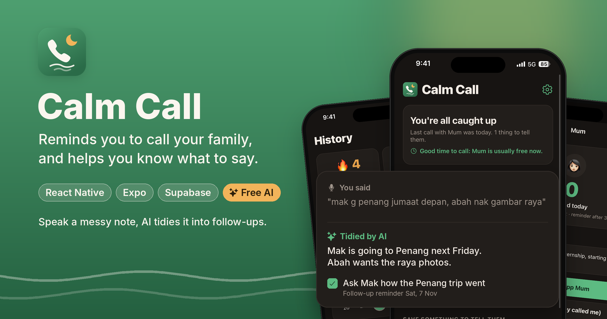
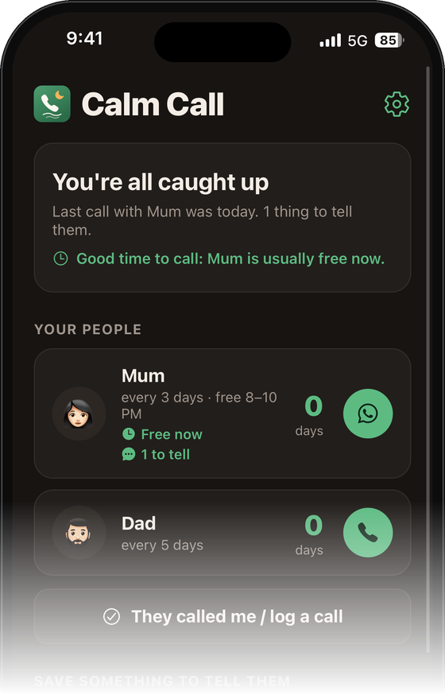
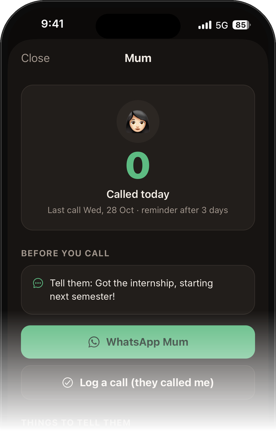
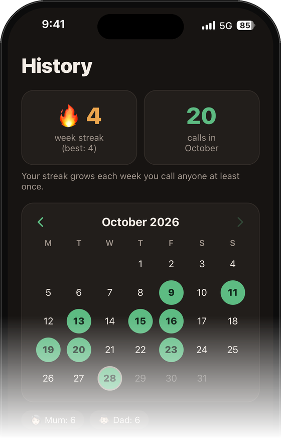
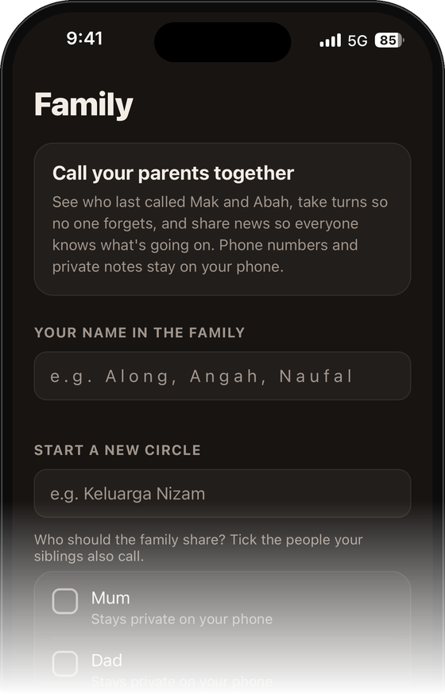
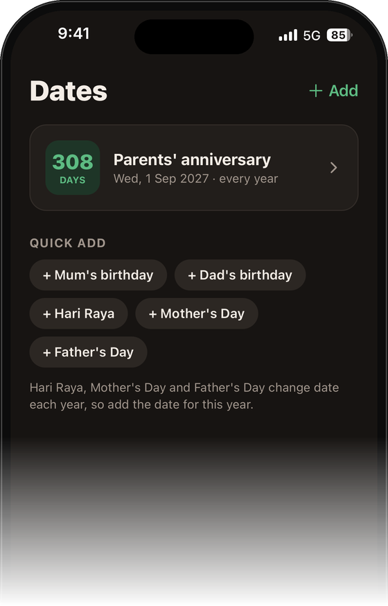
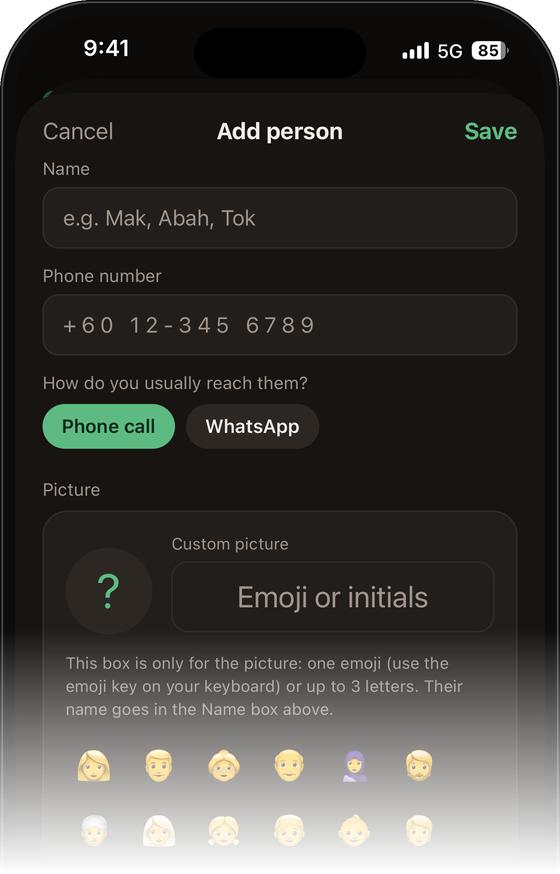
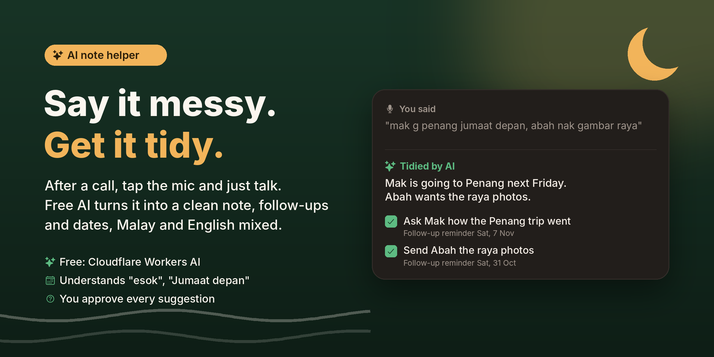

<p align="center">
  
</p>

<p align="center">
  <b>React Native · Expo SDK 58 · TypeScript · Supabase · Cloudflare Workers AI</b>
</p>

---

## A quick tour

<table>
  <tr>
    <td align="center" width="33%">
      <br/>
      <b>Who to call next</b><br/>
      <sub>The most overdue person sits on top, with a hint when they're usually free.</sub>
    </td>
    <td align="center" width="33%">
      <br/>
      <b>Before you call</b><br/>
      <sub>Talking points from your saved news, follow-ups and dates. One tap to call or WhatsApp.</sub>
    </td>
    <td align="center" width="33%">
      <br/>
      <b>Keep the streak alive 🔥</b><br/>
      <sub>Weekly streak, calls this month and a calendar of every call.</sub>
    </td>
  </tr>
  <tr>
    <td align="center" width="33%">
      <br/>
      <b>Call your parents together</b><br/>
      <sub>Siblings share one call log and take turns. You choose who's shared, numbers never leave your phone.</sub>
    </td>
    <td align="center" width="33%">
      <br/>
      <b>Never miss the big days</b><br/>
      <sub>Birthdays, anniversaries, Hari Raya, Mother's and Father's Day, with a countdown.</sub>
    </td>
    <td align="center" width="33%">
      <br/>
      <b>Make it yours</b><br/>
      <sub>Phone or WhatsApp, emoji or initials, and how often you want to be reminded.</sub>
    </td>
  </tr>
</table>

## Why I built it

I kept forgetting to call my parents. It started as a Python Telegram bot, became an iOS Shortcut,
and grew into this app: a calm, friendly nudge to stay in touch with the people who matter,
built around how families in Malaysia actually talk (Malay–English notes, Maghrib timing, siblings taking turns).

## Features

**Staying in touch**
- **Your people:** parents, grandparents, siblings, each with their own "remind me after N days". The most overdue person is always at the top.
- **One-tap calling:** phone or WhatsApp. When you come back, *"How was the call?"* lets you tick off topics, save a note and set a follow-up.
- **Things to tell them:** save news as it happens so you never run out of things to say.
- **Follow-ups:** "Ask how the clinic visit went" comes back on the day you choose.
- **Important dates:** birthdays, anniversaries, Hari Raya, with a heads-up before and a reminder on the day.
- **History:** weekly calling streak 🔥, monthly calendar and notes from past calls.

**Smart timing**
- **Best time to call:** set when each person is usually free, or let the app learn it from your call history ("You usually reach Mak around 8:30–10:30 PM").
- **Avoid Maghrib:** reminders that land during Maghrib move to just after it (prayer times calculated on-device, matched to JAKIM).
- **Reminders that say why:** *"Ask: how the clinic visit went"* or *"Longer than usual. You normally call every 5 days."*

**Family Circle** (Supabase)
- Siblings join one circle with an invite code and share a call log, so a call by anyone counts.
- **Whose turn:** the sibling who has gone longest without calling is reminded first; the others get a backup nudge a few days later.
- Shared news board, and you choose exactly which people are shared.

**AI note helper** (free)
- **Before you call:** talking points from your follow-ups, saved news, upcoming dates and last call (plain code, works offline).
- **Tidy up with AI:** say your note with the keyboard mic, and the AI turns it into a clean note plus follow-ups and dates you can accept or untick. Understands Malay–English mix and relative dates like *"Jumaat depan"*.

<p align="center">
  
</p>

**Also:** Siri & Shortcuts links, emoji or initials avatars, light and dark mode, opening animation that respects Reduce Motion.

## How it works

```
iPhone (Expo app)
 ├─ AsyncStorage ............ your people, calls, notes, dates (stays on the phone)
 ├─ expo-notifications ...... every reminder planned ahead (iOS allows 64 pending)
 ├─ adhan ................... Maghrib times on-device
 └─ Supabase
     ├─ Postgres + RLS ...... Family Circle: circles, members, people, calls, news
     ├─ Realtime ............ siblings see each other's calls instantly
     ├─ Anonymous auth ...... no sign-up needed, each phone gets a silent account
     └─ Edge Function ....... tidy-note → Cloudflare Workers AI (Llama 3.3 70B)
```

- **Reminders are pure functions.** `src/plan.ts` works out every reminder that should exist from the data alone, so it's fully testable; `src/reminders.ts` only hands that plan to iOS.
- **Row-level security** in `supabase/family.sql` means a phone can only read or write circles it belongs to. The publishable key in `src/config.ts` is safe to ship for that reason.
- **The AI key never touches the phone.** The app calls a Supabase Edge Function, which calls Cloudflare with a server-side token. Only the note and the person's name are sent, nothing is stored, and the app re-checks every field the AI returns before using it.

## Run it

1. Install [Node.js](https://nodejs.org) (LTS) and **Expo Go** from the App Store.
2. Clone and start:
   ```bash
   git clone https://github.com/sunquickpapi/calm-call.git
   cd calm-call
   npm install
   npx expo start
   ```
3. Scan the QR code with your iPhone camera.

### Your own backend (optional)
The app works fully offline without it; the Family Circle and AI helper need these.

1. **Supabase:** create a project, run `supabase/family.sql` in the SQL editor, turn on **Anonymous sign-ins**, and put your Project URL and **publishable** key in `src/config.ts` (never the secret key).
2. **AI helper:** deploy `supabase/functions/tidy-note`, then in Cloudflare open **AI → Workers AI → Use REST API**, create a token, and add `CF_ACCOUNT_ID` and `CF_API_TOKEN` as Edge Function secrets in Supabase. Cloudflare's free plan includes a daily allowance and simply pauses when it runs out, so it costs nothing.

### Publish an update to Expo Go
```bash
npm run publish   # EAS Update, channel "main"
```

## Project structure

| Path | What's there |
| --- | --- |
| `App.tsx` | App shell, tabs, opening animation |
| `src/screens/` | Home, Family, History, Dates |
| `src/sheets/` | Person page, after-call, edit person, dates, settings |
| `src/storage.ts` | Data model, saving, date maths |
| `src/plan.ts` · `src/reminders.ts` | Reminder planning (pure) and scheduling |
| `src/smart.ts` | Talking points, learned best time, reminder reasons |
| `src/ai.ts` · `src/aiParse.ts` | AI helper client and output checks |
| `src/prayer.ts` | Maghrib times per city |
| `src/family/` | Family Circle sync, whose-turn logic |
| `src/Intro.tsx` · `src/logo.tsx` | Opening animation and logo |
| `supabase/` | Database schema + RLS, Edge Function |

## Roadmap
- Home-screen widget and push notifications (needs an Apple Developer account)
- A "Rindu" button so parents can nudge their children
- On-device AI with Apple's Foundation Models

## Credits
Phone glyph from [Ionicons](https://ionic.io/ionicons) (MIT). Prayer times by [adhan-js](https://github.com/batoulapps/adhan-js).

Made by **Muhammad Naufal** · [fvlnzm.my](https://fvlnzm.my)
